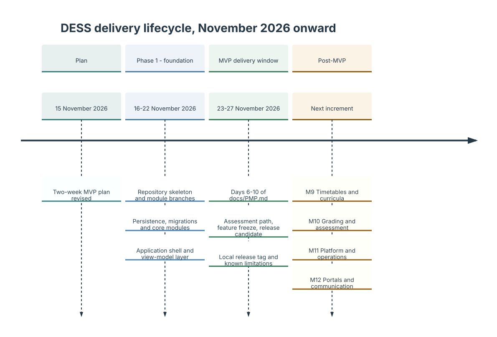
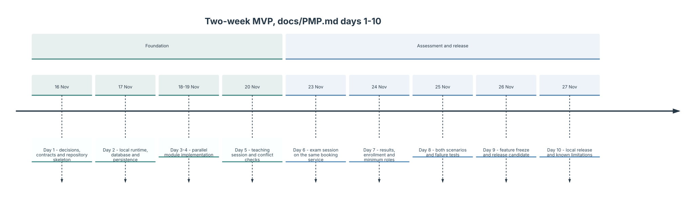

# DESS delivery roadmap

Status: **living document.** Last updated 24 November 2026.

This page is the visual companion to `docs/PMP.md` and the GitHub project. It shows the
delivery lifecycle, the two-week MVP schedule and the milestone horizons. All dates and phases
come from `docs/PMP.md` sections 9 and 12, `docs/phase-1-history.md` and the GitHub milestones.
Nothing here adds a requirement.

## 1. Delivery lifecycle

Every issue moves through the same five board columns. The gates between them are the rules in
`AGENTS.md` and `docs/PMP.md` section 13.



- **Backlog** - the issue exists and is triaged.
- **Ready** - it has an owner, a priority, a milestone and testable acceptance criteria.
- **In progress** - a branch and a pull request exist.
- **In review** - review is requested and CI is running.
- **Done** - the change is merged to `dev`, tests pass and the docs are updated.

Only Sergio merges into `main`. A release is cut from `main`, not from `dev`.

## 2. Delivery phases



| Phase | Window | State | Evidence |
| --- | --- | --- | --- |
| Plan | 15 November 2026 | Complete | `docs/PMP.md` revised working plan. |
| Phase 1 - foundation | 16-22 November 2026 | Delivered | Repository skeleton, persistence, core modules, application shell. Record: `docs/phase-1-history.md` and issue #37. |
| MVP delivery window | 23-27 November 2026 | In progress | Days 6-10 of `docs/PMP.md`: assessment path, feature freeze, release candidate, local release. |
| Post-MVP | After the MVP | Not scheduled | Milestones M9-M12. Each starts only after the MVP release. |

Phase 1 is a record, not a promise that every planned feature landed. The open gaps are tracked
as issues, for example the academic core under parent issue #15 and the OpenAPI validation in
issue #156.

## 3. Two-week MVP by day



| Day | Date | Main work | End-of-day evidence |
| ---: | --- | --- | --- |
| 1 | 16 November 2026 | Decisions, module contracts, project skeleton, booking contract. | Written contracts; repository skeleton builds. |
| 2 | 17 November 2026 | WildFly, PostgreSQL, first migrations, shared errors, Testcontainers, seed data, CI. | A developer starts the application and persists one record. |
| 3-4 | 18-19 November 2026 | Parallel module implementation: institution, people, academic, scheduling, assessment, security. | Each workstream demonstrates its minimum use cases. |
| 5 | 20 November 2026 | First integrated path: schedule a teaching session and reject conflicts. | Course session saved; overlapping room, teacher or group booking rejected clearly. |
| 6 | 23 November 2026 | Exam session on the same booking service; candidate eligibility and supervisors. | An exam is scheduled without bypassing the booking service. |
| 7 | 24 November 2026 | Result entry and retrieval, program enrollment, minimum roles, end-to-end API. | The full high-school path runs through the API. |
| 8 | 25 November 2026 | University scenario, invalid XML and hierarchy, concurrent booking tests. | Both institution scenarios and failure tests pass. |
| 9 | 26 November 2026 | Feature freeze, critical fixes, clean-checkout setup, docs, security and regression pass. | Release candidate starts locally from a clean checkout. |
| 10 | 27 November 2026 | Run the local setup, demonstrate, tag the release, list limitations. | Local MVP demonstrated and release tag created. |

Critical milestones are Day 2, Day 5, Day 7, Day 8 and Day 10.

## 4. Milestones and horizons



| Milestone | Horizon | Issues | Done | Focus |
| --- | --- | ---: | ---: | --- |
| M1 Teaching path | MVP | 11 | 2 | StudentGroup, group enrollment, CourseOffering, teaching assignment and TeachingSession. |
| M2 Platform and DevOps | MVP | 21 | 1 | CI, bootstrap, backup, health checks, release rehearsal. |
| M3 Scheduling hardening | MVP | 10 | 2 | Group booking, conflict boundaries, concurrency and booking contract tests. |
| M4 Assessment UI | MVP | 18 | 3 | Assessment definitions, eligibility, result entry and exam session pages. |
| M5 Academic UI and security | MVP | 14 | 2 | People and academic pages, account persistence, permission tests. |
| M6 Institution and configuration | MVP | 9 | 7 | Hierarchy rules, XML import errors, sample configurations, editor accessibility. |
| M7 Frontend and UX | MVP | 13 | 1 | Responsive pages, empty and error states, accessibility and UI regression. |
| M8 Testing and quality | MVP | 19 | 5 | MVP regression suite, Testcontainers matrix, coverage and performance baseline. |
| M9 Post-MVP: timetables and curricula | Post-MVP | 9 | 0 | Recurring templates, timetable optimization, curriculum modules, prerequisites. |
| M10 Post-MVP: grading and assessment | Post-MVP | 3 | 0 | Weighted grading, averages, retakes, rankings and publication. |
| M11 Post-MVP: platform and operations | Post-MVP | 7 | 0 | Monitoring, API clients, full-stack Compose, failure tests. |
| M12 Post-MVP: portals and communication | Post-MVP | 1 | 0 | Student and parent portals, notifications and delivery history. |

Issue counts are a snapshot from the GitHub milestones on 24 November 2026. They change as
issues are triaged, so read the board for the current numbers. The dependency arrows in the
graphic follow `docs/PMP.md`: the teaching path unlocks scheduling and assessment work, the
platform foundation unlocks quality work, and post-MVP packages start from the MVP modules they
extend.

## 5. How the graphics are built

The sources are Mermaid files in `docs/roadmap/`. Regenerate every SVG with Mermaid CLI 12:

```bash
for f in lifecycle phases mvp-days milestones; do
    mmdc -i "docs/roadmap/$f.mmd" \
        -o "docs/roadmap/$f.svg" \
        -c docs/roadmap/mermaid-config.json \
        -b white --size 1400
done
```

The theme uses the DESS design tokens: primary and accent colours for structure, the soft
success, warning and info surfaces for phases, and the body text token for labels. Do not edit a
generated SVG by hand. Change the `.mmd` source or `mermaid-config.json` and render again.
