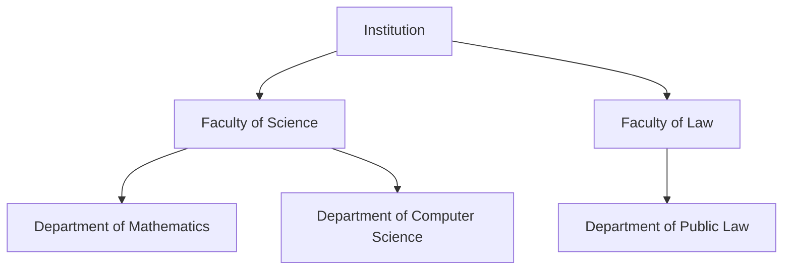
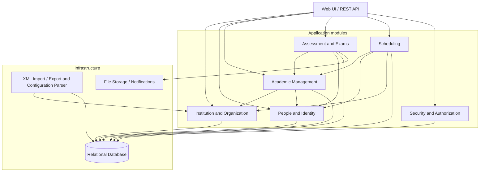
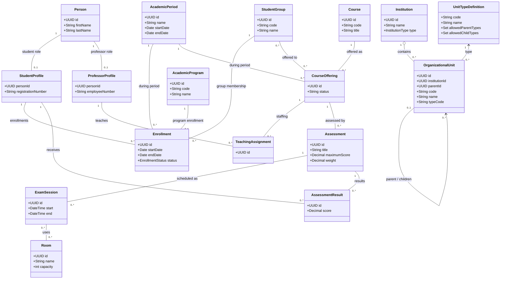

# Academic Institution Management System — Architecture Summary

## 1. Project goal

Design one application that can manage academic activities for different kinds of educational institutions, including:

- Middle schools and high schools
- Colleges and universities
- Specialized or professional training institutions

The first functional scope focuses on institutional structure, people, academic organization, examinations, grades, and timetables. Broader institutional administration can be added later.

The central architectural challenge is to support different institutional structures without creating a separate application—or a large set of Java classes—for every institution type.

---

## 2. Main architectural decision

**Use an explicit academic domain model with a flexible organizational structure.**

The application should understand stable academic concepts such as students, professors, courses, enrollments, examinations, and results. However, it should not need a distinct Java class for every possible organizational unit, such as a faculty, department, school, section, or training center.

The design therefore separates two models:

1. **Organizational hierarchy:** a tree of organizational units. This is where a Composite-style model can be useful.
2. **Academic domain:** entities and relationships that form a graph rather than one tree. Examples include student enrollment, professor teaching assignments, course offerings, examinations, and results.

These models are connected by explicit identifiers and relationships, but they should not be collapsed into one universal `Node` class.

### Design principles

- Keep the domain vocabulary explicit.
- Use generic structural objects where structural units differ mainly by type and metadata.
- Use dedicated Java classes where concepts have meaningful behavior, identity, lifecycle, or business rules.
- Use configuration for institutional variation, not as an unrestricted programming language.
- Keep the first implementation as a modular monolith.
- Use a relational database as the operational source of truth.

---

## 3. Where the Composite pattern fits

Composite is appropriate for the **organizational hierarchy** when the application needs to treat a unit and its descendants uniformly—for example, traversing a faculty's departments and all their subunits.

Example:



A faculty, department, campus, or section can be represented by the same `OrganizationalUnit` Java class, distinguished by a `UnitType`. There is no automatic need for `Faculty extends OrganizationalUnit`, `Department extends OrganizationalUnit`, and so on.

A generic sketch:

```java
public class OrganizationalUnit {
    private UUID id;
    private UUID institutionId;
    private String code;
    private String name;
    private UnitTypeDefinition type;
    private UUID parentId;
}
```

A service or repository can load and traverse the hierarchy. The object model may expose children when recursive operations are useful, but the GoF Composite pattern is not mandatory merely because the database contains a tree.

### Where Composite does not fit

Do not force every academic object into the hierarchy. A student can be enrolled in a program, belong to a group during one academic period, register for courses, and sit examinations organized by different units. A professor can teach courses associated with more than one department. These are relationships, not simple parent-child containment.

Therefore, do not make `Student`, `Professor`, `Course`, `Exam`, `Room`, or `AssessmentResult` children of a universal academic `Node`.

---

## 4. Structural types without a class for every type

The application should know the standard vocabulary, but this does not require a separate Java class for every term.

Examples of recognized structural type codes:

- `CAMPUS`
- `FACULTY`
- `DEPARTMENT`
- `SCHOOL`
- `SECTION`
- `GRADE`
- `ACADEMIC_LEVEL`
- `CLASS_GROUP`

An institution may also define custom structural types, such as `RESEARCH_CENTER` or `SPECIAL_TRAINING_CYCLE`.

A type definition can describe the type's code, display name, allowed parent/child types, and custom attribute definitions.

```java
public class UnitTypeDefinition {
    private String code;
    private String name;
    private Set<String> allowedParentTypes;
    private Set<String> allowedChildTypes;
    private Map<String, AttributeDefinition> attributes;
}
```

The actual structural instances use one generic representation:

```java
public class OrganizationalUnit {
    private UUID id;
    private UUID institutionId;
    private UUID parentId;
    private String code;
    private String name;
    private String typeCode;
    private Map<String, Object> customAttributes;
}
```

`customAttributes` should be limited to genuinely custom metadata. Their definitions and values need validation. Important domain concepts should not be reduced to arbitrary key-value maps.

### Standard types and custom types

A useful distinction is:

- **Recognized standard type:** the application knows its meaning and may apply specific validation or services.
- **Custom structural type:** the application can store, display, organize, and validate it generically, but does not automatically infer academic behavior from its name.

If a custom type needs special academic behavior, that behavior must be supported explicitly by the application—for example, through a declared capability backed by a known Java service or policy. XML should not contain arbitrary executable business logic.

---

## 5. Important domain concepts

The following is the proposed domain vocabulary. It is a conceptual starting point, not a final database schema.

### Institution and organization

- `Institution`: the educational organization using the application.
- `OrganizationalUnit`: a generic node in the institution's organizational hierarchy.
- `UnitTypeDefinition`: describes a standard or custom organizational-unit type.
- `Campus`: can be represented as a recognized organizational-unit type if it belongs in the hierarchy.

### People and academic participation

- `Person`: shared identity and personal information.
- `StudentProfile`: student-specific information for a person.
- `ProfessorProfile`: professor-specific information for a person.
- `StudentGroup`: a teaching/cohort group with a roster and an academic period.
- `Enrollment`: connects a student to a program or group over a defined period.
- Teaching assignment: connects a professor to a course offering or teaching activity.

A person can potentially have more than one role. Separating `Person` from `StudentProfile` and `ProfessorProfile` avoids duplicating personal data.

### Curriculum and academic periods

- `AcademicPeriod`: an academic year, semester, trimester, term, or another configured period.
- `AcademicProgram`: a program of study, such as a Bachelor's degree in Computer Science.
- `ProgramVersion`: optional, if curricula change over time and old cohorts must retain the curriculum they started under.
- `Course`: a reusable course/subject definition.
- `CourseOffering`: a specific delivery of a course during an academic period to a group or set of students, with assigned teaching staff.

A `Course` is not the same as a `CourseOffering`. The same course may be delivered to multiple groups, in different periods, or by different professors.

### Assessment and scheduling

- `Assessment`: an evaluation associated with a course offering (exam, test, practical evaluation, etc.).
- `ExamSession`: the scheduled occurrence of an examination, with start/end time, rooms, and supervisors.
- `AssessmentResult`: a student's result for an assessment.
- `Room`: a physical resource with capacity and other constraints.
- `TeachingSession`: a scheduled teaching activity for a course offering.
- Scheduling/conflict services: validate room, professor, group, and time constraints.

Distinguishing `Assessment` from `ExamSession` allows one assessment to be conducted across multiple rooms or sessions when necessary.

---

## 6. Architecture overview

Recommended initial deployment: a **modular monolith**. The modules are separated by responsibility and interfaces, but run as one application and can share one relational database.



The arrows indicate conceptual dependencies, not necessarily direct calls between every pair of modules. Keep dependencies explicit and avoid circular module dependencies. In particular, an assessment use case should use academic/application interfaces rather than directly manipulating another module's tables.

### Suggested Java package layout

```text
com.example.academic
├── institution
│   ├── domain
│   ├── application
│   └── infrastructure
├── people
│   ├── domain
│   ├── application
│   └── infrastructure
├── academic
│   ├── domain
│   ├── application
│   └── infrastructure
├── assessment
│   ├── domain
│   ├── application
│   └── infrastructure
├── scheduling
│   ├── domain
│   ├── application
│   └── infrastructure
├── security
└── shared
```

Within each module:

- **Domain:** entities, value objects, domain rules, and domain services.
- **Application:** use cases, commands, orchestration, and module-facing interfaces.
- **Infrastructure:** database repositories, XML parsing, external systems, and framework-specific code.

---

## 7. Class model sketch

This Mermaid diagram shows the main class relationships. It is intentionally simplified: method signatures, persistence annotations, and many attributes are omitted.



### Important modeling boundary: `AcademicProgram` and `StudentGroup`

These are boundary cases worth deciding carefully.

- If a program is only a label in an organizational tree, it could be represented as an `OrganizationalUnit` with type `PROGRAM`.
- If a program has a curriculum, versions, admission requirements, awards, and student enrollments, it should be an explicit `AcademicProgram` domain entity. It may reference the organizational unit responsible for it.
- If a class group is only a structural subdivision, it could be an organizational unit.
- If a group has a roster, memberships over time, course offerings, and a timetable, it should be an explicit `StudentGroup` domain entity. It can be linked to its responsible organizational unit.

The recommendation for a real academic management system is to make `AcademicProgram` and `StudentGroup` explicit domain entities when they carry these operational responsibilities. Do not create two competing representations of the same thing without a clear reason. If both organizational placement and academic behavior are needed, link the domain entity to its owning organizational unit.

---

## 8. Configuration and XML

XML can be used to initialize, import, or export institutional structure and configuration. It should not be the primary store for operational academic data such as grades, enrollments, and examination sessions.

A configuration might define types and allowed hierarchy relationships:

```xml
<institution id="university-01" name="Example University">
    <unit-types>
        <unit-type code="FACULTY" name="Faculty" />
        <unit-type code="DEPARTMENT" name="Department" />
        <unit-type code="SECTION" name="Section" />
    </unit-types>

    <hierarchy-rules>
        <allow parent="FACULTY" child="DEPARTMENT" />
        <allow parent="DEPARTMENT" child="SECTION" />
    </hierarchy-rules>

    <structure>
        <unit type="FACULTY" code="SCI" name="Faculty of Science">
            <unit type="DEPARTMENT" code="CS" name="Computer Science" />
        </unit>
    </structure>
</institution>
```

Use two levels of validation:

1. **Syntactic/structural validation:** XML well-formedness, expected elements, attributes, and basic data types. XSD can help here.
2. **Semantic validation:** whether a child type is allowed under a parent type, identifiers are unique, references exist, and institution-specific rules are satisfied. This belongs in Java application/domain code.

Configuration should describe types, permitted structures, and parameters. Java code should implement business behavior. Avoid turning XML into an unrestricted executable rules language.

### Configuration lifecycle

Institutional structure can change. Define rules for:

- Creating a unit
- Renaming a unit
- Moving a unit to another parent
- Deactivating a unit
- Preventing deletion when historical records still reference it
- Versioning configuration so historical academic records remain interpretable

Use stable identifiers rather than relying on names or hierarchy paths. Prefer deactivation/archiving over destructive deletion for referenced units.

---

## 9. Database direction

Use a relational database such as PostgreSQL for operational data.

Likely tables include:

- `institution`
- `unit_type_definition`
- `organizational_unit`
- `person`
- `student_profile`
- `professor_profile`
- `academic_program`
- `academic_period`
- `student_group`
- `enrollment`
- `course`
- `course_offering`
- `teaching_assignment`
- `assessment`
- `exam_session`
- `assessment_result`
- `room`
- `schedule_entry` or equivalent scheduling tables

A self-referencing `organizational_unit.parent_id` supports the hierarchy. Foreign keys and unique constraints should protect data integrity. Additional domain validation is needed for rules that are too complex for ordinary relational constraints.

---

## 10. Example use case: create and schedule an examination

A useful vertical slice for validating the architecture is:

1. Retrieve the relevant `CourseOffering`.
2. Verify that it belongs to the intended academic period and group(s).
3. Create an `Assessment` associated with the course offering.
4. Create one or more `ExamSession` records.
5. Assign rooms and supervisors.
6. Check room, group, and supervisor conflicts.
7. Determine eligible students from course registration/enrollment rules.
8. Record `AssessmentResult` records after the examination.

This use case tests both sides of the architecture: organizational context and explicit academic relationships.

---

## 11. Implementation order

Build incrementally, using one end-to-end use case to test each architectural decision.

1. **Define the domain vocabulary and invariants.** Agree on the meanings of institution, organizational unit, program, group, enrollment, course offering, assessment, and exam session.
2. **Implement the organizational model.** Include type definitions, hierarchy validation, and stable IDs.
3. **Implement people and identity.** Keep personal identity distinct from student/professor roles and application accounts.
4. **Implement academic periods, programs, groups, and enrollment.** Add historical membership rules.
5. **Implement courses and course offerings.** Distinguish course catalog definitions from actual delivery.
6. **Implement assessments and exam sessions.** Add candidate eligibility and results.
7. **Implement scheduling and conflict detection.** Reuse scheduling policies across teaching and examinations.
8. **Add XML import/export and institution-specific configuration.** Validate both syntax and semantics.

Start with a modular monolith, not microservices. Do not build a generic metadata/rules engine until concrete institution requirements demonstrate that it is needed.

---

## 12. Decisions and questions still open

These were not fully settled in the discussion and should be decided during domain modeling:

1. **Program representation:** Is an academic program an organizational unit, an explicit academic entity, or an entity linked to an organizational unit? Recommendation: explicit entity when it has curriculum, enrollment, and versioning behavior.
2. **Class/group representation:** Is a class group purely structural, or does it have its own roster, timetable, and lifecycle? Recommendation: explicit `StudentGroup` when it has operational academic responsibilities.
3. **Institutional cardinalities:** Can an institution have multiple campuses? Can a department belong to more than one faculty? Can a program be jointly managed by departments?
4. **Student participation:** Can a student be enrolled in multiple programs or groups simultaneously? How are transfers and historical enrollments represented?
5. **Teaching assignments:** Can a course offering have multiple professors? Can one professor teach multiple groups together?
6. **Academic calendar:** Which period types are needed, and can periods overlap?
7. **Grading policies:** Are grades numerical, letter-based, weighted, or institution-specific? How are averages and retakes calculated?
8. **Examination organization:** Can an assessment have multiple sessions, rooms, candidate lists, or attempts?
9. **Configuration changes:** Should configuration versions be tied to academic years or effective dates?

These questions should be answered from actual use cases rather than by trying to anticipate every possible institution.

---

## 13. Final recommendation

The proposed direction is:

- **Explicit domain:** `Institution`, `Person`, `StudentProfile`, `ProfessorProfile`, `AcademicProgram`, `Course`, `CourseOffering`, `Enrollment`, `Assessment`, `ExamSession`, and other concepts with stable academic meaning.
- **Flexible structure:** generic `OrganizationalUnit` instances identified by `UnitTypeDefinition`, with configurable hierarchy rules and support for custom types.
- **Composite where useful:** use a Composite-compatible tree for organizational units and recursive hierarchy operations, but do not force all academic entities into it.
- **Explicit relationships:** represent enrollment, teaching assignments, course offerings, exam participation, and results as domain relationships.
- **Configuration:** XML/XSD for institutional structure and configuration, with Java semantic validation.
- **Persistence:** relational database for operational data.
- **Deployment:** modular monolith as the initial architecture.

The guiding principle is: **explicit academic semantics, flexible organizational structure, and no universal object model for unrelated concepts.**
