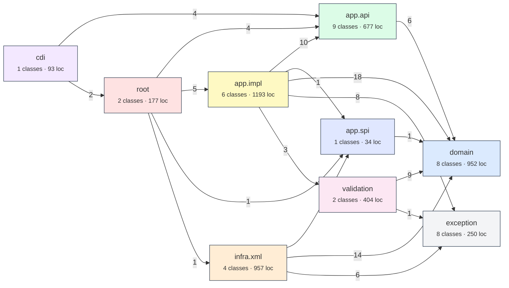

# Institution module — dependency graph

Generated from the production sources of `com.dess.institution` on 2026-11-17.

**Method.** Comments, text blocks and string literals are stripped from every `.java` file;
an edge `A → B` means the source of `A` references the identifier `B` (imports *and*
same-package references count). Strongly connected components are computed with Tarjan's
algorithm. Test sources are not part of the graph.

## Summary

| Metric | Value |
|---|---:|
| Top-level classes | 41 |
| Dependency edges | 132 |
| Packages | 9 |
| Strongly connected components (cycles) | 0 |
| Total production lines | 4737 |

No package-level cycle exists: dependencies point from the outer layers
(`root`, `cdi`, `infrastructure`, `application`) toward `domain`, and `domain`
depends only on itself and the JDK.

## Package graph

## Class graph

```mermaid
flowchart TD
  subgraph L_root["root (2)"]
    InstitutionModule["InstitutionModule<br/><small>124 loc</small>"]
    InstitutionSettings["InstitutionSettings<br/><small>53 loc</small>"]
  end
  subgraph L_cdi["cdi (1)"]
    InstitutionProducers["InstitutionProducers<br/><small>93 loc</small>"]
  end
  subgraph L_app_api["app.api (9)"]
    AttributeService["AttributeService<br/><small>138 loc</small>"]
    ConfigurationStatus["ConfigurationStatus<br/><small>17 loc</small>"]
    CreateUnitCommand["CreateUnitCommand<br/><small>42 loc</small>"]
    HierarchyService["HierarchyService<br/><small>205 loc</small>"]
    InstitutionInfo["InstitutionInfo<br/><small>13 loc</small>"]
    InstitutionService["InstitutionService<br/><small>81 loc</small>"]
    UnitTypeService["UnitTypeService<br/><small>131 loc</small>"]
    UpdateUnitCommand["UpdateUnitCommand<br/><small>19 loc</small>"]
    ValidationReport["ValidationReport<br/><small>31 loc</small>"]
  end
  subgraph L_app_impl["app.impl (6)"]
    AttributeServiceImpl["AttributeServiceImpl<br/><small>313 loc</small>"]
    ConfigurationHolder["ConfigurationHolder<br/><small>139 loc</small>"]
    HierarchyServiceImpl["HierarchyServiceImpl<br/><small>374 loc</small>"]
    InstitutionServiceImpl["InstitutionServiceImpl<br/><small>101 loc</small>"]
    UnitTypeServiceImpl["UnitTypeServiceImpl<br/><small>209 loc</small>"]
    UnitValues["UnitValues<br/><small>57 loc</small>"]
  end
  subgraph L_app_spi["app.spi (1)"]
    ConfigPersistence["ConfigPersistence<br/><small>34 loc</small>"]
  end
  subgraph L_validation["validation (2)"]
    AttributeValidator["AttributeValidator<br/><small>118 loc</small>"]
    InstitutionValidator["InstitutionValidator<br/><small>286 loc</small>"]
  end
  subgraph L_infra_xml["infra.xml (4)"]
    InstitutionConfigRepository["InstitutionConfigRepository<br/><small>168 loc</small>"]
    SecureXml["SecureXml<br/><small>112 loc</small>"]
    XmlConfigLoader["XmlConfigLoader<br/><small>421 loc</small>"]
    XmlConfigWriter["XmlConfigWriter<br/><small>256 loc</small>"]
  end
  subgraph L_domain["domain (8)"]
    AllowedParentChildPair["AllowedParentChildPair<br/><small>24 loc</small>"]
    AttributeDefinition["AttributeDefinition<br/><small>84 loc</small>"]
    AttributeType["AttributeType<br/><small>231 loc</small>"]
    AttributeValue["AttributeValue<br/><small>25 loc</small>"]
    InstitutionConfig["InstitutionConfig<br/><small>304 loc</small>"]
    OrganizationalUnit["OrganizationalUnit<br/><small>126 loc</small>"]
    Texts["Texts<br/><small>47 loc</small>"]
    UnitTypeDefinition["UnitTypeDefinition<br/><small>111 loc</small>"]
  end
  subgraph L_exception["exception (8)"]
    ConfigurationLoadException["ConfigurationLoadException<br/><small>36 loc</small>"]
    ConfigurationSaveException["ConfigurationSaveException<br/><small>33 loc</small>"]
    InstitutionException["InstitutionException<br/><small>30 loc</small>"]
    MalformedXmlException["MalformedXmlException<br/><small>22 loc</small>"]
    NotFoundException["NotFoundException<br/><small>21 loc</small>"]
    NotInitializedException["NotInitializedException<br/><small>21 loc</small>"]
    SchemaViolationException["SchemaViolationException<br/><small>38 loc</small>"]
    ValidationException["ValidationException<br/><small>49 loc</small>"]
  end
  AllowedParentChildPair --> Texts
  AttributeDefinition --> AttributeType
  AttributeDefinition --> Texts
  AttributeService --> AttributeDefinition
  AttributeService --> AttributeValue
  AttributeService --> ValidationReport
  AttributeServiceImpl --> AttributeDefinition
  AttributeServiceImpl --> AttributeService
  AttributeServiceImpl --> AttributeValidator
  AttributeServiceImpl --> AttributeValue
  AttributeServiceImpl --> ConfigurationHolder
  AttributeServiceImpl --> InstitutionConfig
  AttributeServiceImpl --> NotFoundException
  AttributeServiceImpl --> OrganizationalUnit
  AttributeServiceImpl --> Texts
  AttributeServiceImpl --> UnitTypeDefinition
  AttributeServiceImpl --> UnitValues
  AttributeServiceImpl --> ValidationException
  AttributeServiceImpl --> ValidationReport
  AttributeValidator --> AttributeDefinition
  AttributeValidator --> AttributeValue
  AttributeValidator --> Texts
  AttributeValidator --> UnitTypeDefinition
  AttributeValue --> Texts
  ConfigPersistence --> InstitutionConfig
  ConfigurationHolder --> ConfigPersistence
  ConfigurationHolder --> InstitutionConfig
  ConfigurationHolder --> InstitutionValidator
  ConfigurationHolder --> NotInitializedException
  ConfigurationHolder --> ValidationException
  ConfigurationLoadException --> InstitutionException
  ConfigurationSaveException --> InstitutionException
  HierarchyService --> CreateUnitCommand
  HierarchyService --> OrganizationalUnit
  HierarchyService --> UpdateUnitCommand
  HierarchyServiceImpl --> ConfigurationHolder
  HierarchyServiceImpl --> CreateUnitCommand
  HierarchyServiceImpl --> HierarchyService
  HierarchyServiceImpl --> InstitutionConfig
  HierarchyServiceImpl --> NotFoundException
  HierarchyServiceImpl --> OrganizationalUnit
  HierarchyServiceImpl --> Texts
  HierarchyServiceImpl --> UnitTypeDefinition
  HierarchyServiceImpl --> UnitValues
  HierarchyServiceImpl --> UpdateUnitCommand
  HierarchyServiceImpl --> ValidationException
  InstitutionConfig --> AllowedParentChildPair
  InstitutionConfig --> OrganizationalUnit
  InstitutionConfig --> Texts
  InstitutionConfig --> UnitTypeDefinition
  InstitutionConfigRepository --> ConfigPersistence
  InstitutionConfigRepository --> ConfigurationSaveException
  InstitutionConfigRepository --> InstitutionConfig
  InstitutionConfigRepository --> InstitutionException
  InstitutionConfigRepository --> XmlConfigLoader
  InstitutionConfigRepository --> XmlConfigWriter
  InstitutionModule --> AttributeService
  InstitutionModule --> AttributeServiceImpl
  InstitutionModule --> ConfigPersistence
  InstitutionModule --> ConfigurationHolder
  InstitutionModule --> HierarchyService
  InstitutionModule --> HierarchyServiceImpl
  InstitutionModule --> InstitutionConfigRepository
  InstitutionModule --> InstitutionService
  InstitutionModule --> InstitutionServiceImpl
  InstitutionModule --> InstitutionSettings
  InstitutionModule --> UnitTypeService
  InstitutionModule --> UnitTypeServiceImpl
  InstitutionProducers --> AttributeService
  InstitutionProducers --> HierarchyService
  InstitutionProducers --> InstitutionModule
  InstitutionProducers --> InstitutionService
  InstitutionProducers --> InstitutionSettings
  InstitutionProducers --> UnitTypeService
  InstitutionService --> ConfigurationStatus
  InstitutionService --> InstitutionConfig
  InstitutionService --> InstitutionInfo
  InstitutionService --> ValidationReport
  InstitutionServiceImpl --> ConfigurationHolder
  InstitutionServiceImpl --> ConfigurationStatus
  InstitutionServiceImpl --> InstitutionConfig
  InstitutionServiceImpl --> InstitutionInfo
  InstitutionServiceImpl --> InstitutionService
  InstitutionServiceImpl --> InstitutionValidator
  InstitutionServiceImpl --> ValidationReport
  InstitutionValidator --> AllowedParentChildPair
  InstitutionValidator --> AttributeValidator
  InstitutionValidator --> InstitutionConfig
  InstitutionValidator --> OrganizationalUnit
  InstitutionValidator --> Texts
  InstitutionValidator --> UnitTypeDefinition
  InstitutionValidator --> ValidationException
  MalformedXmlException --> ConfigurationLoadException
  NotFoundException --> InstitutionException
  NotInitializedException --> InstitutionException
  OrganizationalUnit --> AttributeValue
  OrganizationalUnit --> Texts
  SchemaViolationException --> ConfigurationLoadException
  UnitTypeDefinition --> AttributeDefinition
  UnitTypeDefinition --> Texts
  UnitTypeService --> AllowedParentChildPair
  UnitTypeService --> UnitTypeDefinition
  UnitTypeServiceImpl --> AllowedParentChildPair
  UnitTypeServiceImpl --> ConfigurationHolder
  UnitTypeServiceImpl --> InstitutionConfig
  UnitTypeServiceImpl --> NotFoundException
  UnitTypeServiceImpl --> UnitTypeDefinition
  UnitTypeServiceImpl --> UnitTypeService
  UnitTypeServiceImpl --> ValidationException
  UnitValues --> AttributeDefinition
  UnitValues --> AttributeValue
  UnitValues --> UnitTypeDefinition
  ValidationException --> InstitutionException
  XmlConfigLoader --> AllowedParentChildPair
  XmlConfigLoader --> AttributeDefinition
  XmlConfigLoader --> AttributeType
  XmlConfigLoader --> AttributeValue
  XmlConfigLoader --> ConfigurationLoadException
  XmlConfigLoader --> InstitutionConfig
  XmlConfigLoader --> MalformedXmlException
  XmlConfigLoader --> OrganizationalUnit
  XmlConfigLoader --> SchemaViolationException
  XmlConfigLoader --> SecureXml
  XmlConfigLoader --> UnitTypeDefinition
  XmlConfigWriter --> AllowedParentChildPair
  XmlConfigWriter --> AttributeDefinition
  XmlConfigWriter --> AttributeValue
  XmlConfigWriter --> ConfigurationSaveException
  XmlConfigWriter --> InstitutionConfig
  XmlConfigWriter --> OrganizationalUnit
  XmlConfigWriter --> SecureXml
  XmlConfigWriter --> UnitTypeDefinition
  style L_root fill:#fee2e2,stroke:#334155
  style L_cdi fill:#f3e8ff,stroke:#334155
  style L_app_api fill:#dcfce7,stroke:#334155
  style L_app_impl fill:#fef9c3,stroke:#334155
  style L_app_spi fill:#e0e7ff,stroke:#334155
  style L_validation fill:#fce7f3,stroke:#334155
  style L_infra_xml fill:#ffedd5,stroke:#334155
  style L_domain fill:#dbeafe,stroke:#334155
  style L_exception fill:#f3f4f6,stroke:#334155
```

All 41 classes and 132 edges

A Graphviz version of the same graph is available in
[`institution-dependency-graph.dot`](institution-dependency-graph.dot).

## Layers and allowed dependency direction

| Layer | Classes | LOC | Allowed to depend on |
|---|---:|---:|---|
| `root` | 2 | 177 | every layer (composition root) |
| `cdi` | 1 | 93 | `app.api`, `root` |
| `app.api` | 9 | 677 | `domain` |
| `app.impl` | 6 | 1193 | `app.api`, `app.spi`, `domain`, `validation`, `exception` |
| `app.spi` | 1 | 34 | `domain` |
| `validation` | 2 | 404 | `domain`, `exception` |
| `infra.xml` | 4 | 957 | `app.spi`, `domain`, `exception` |
| `domain` | 8 | 952 | nothing outside `domain` (JDK only) |
| `exception` | 8 | 250 | nothing (leaf layer) |

## Hubs

| Class | Layer | LOC | Fan-in | Fan-out | Transitive dependencies |
|---|---|---:|---:|---:|---:|
| `InstitutionConfig` | domain | 304 | 11 | 4 | 7 |
| `Texts` | domain | 47 | 10 | 0 | 0 |
| `UnitTypeDefinition` | domain | 111 | 10 | 2 | 3 |
| `AttributeDefinition` | domain | 84 | 7 | 2 | 2 |
| `AttributeValue` | domain | 25 | 7 | 1 | 1 |
| `OrganizationalUnit` | domain | 126 | 7 | 2 | 2 |
| `AllowedParentChildPair` | domain | 24 | 6 | 1 | 1 |
| `InstitutionException` | exception | 30 | 6 | 0 | 0 |
| `ConfigurationHolder` | app.impl | 139 | 5 | 5 | 14 |
| `ValidationException` | exception | 49 | 5 | 1 | 1 |
| `ValidationReport` | app.api | 31 | 4 | 0 | 0 |
| `AttributeService` | app.api | 138 | 3 | 3 | 5 |

`InstitutionConfig` and `Texts` are the intended domain hubs. `InstitutionModule` has a high
fan-out by design: it is the composition root that wires every implementation.

## Refactoring recorded by this graph

The graph previously contained 43 classes and one cycle:
`InstitutionValidator ↔ HierarchyValidator` (`HierarchyValidator` read
`InstitutionValidator.CODE_PATTERN` while the validator called it). The single-caller
validator was merged into `InstitutionValidator`, which also absorbed the hierarchy rules.

`AttributeValueConverter` was folded into `AttributeType`: each enum constant now implements
its own `parse`, removing the `switch` on the type and the risk of adding a constant without
its conversion rule. The converter's test moved to `AttributeTypeTest`.

Result: **41 classes, 132 edges, 0 cycles**.

## Full metrics

| Class | Layer | LOC | Fan-in | Fan-out | Transitive dependencies |
|---|---|---:|---:|---:|---:|
| `AllowedParentChildPair` | domain | 24 | 6 | 1 | 1 |
| `AttributeDefinition` | domain | 84 | 7 | 2 | 2 |
| `AttributeService` | app.api | 138 | 3 | 3 | 5 |
| `AttributeServiceImpl` | app.impl | 313 | 1 | 13 | 19 |
| `AttributeType` | domain | 231 | 2 | 0 | 0 |
| `AttributeValidator` | validation | 118 | 2 | 4 | 5 |
| `AttributeValue` | domain | 25 | 7 | 1 | 1 |
| `ConfigPersistence` | app.spi | 34 | 3 | 1 | 8 |
| `ConfigurationHolder` | app.impl | 139 | 5 | 5 | 14 |
| `ConfigurationLoadException` | exception | 36 | 3 | 1 | 1 |
| `ConfigurationSaveException` | exception | 33 | 2 | 1 | 1 |
| `ConfigurationStatus` | app.api | 17 | 2 | 0 | 0 |
| `CreateUnitCommand` | app.api | 42 | 2 | 0 | 0 |
| `HierarchyService` | app.api | 205 | 3 | 3 | 5 |
| `HierarchyServiceImpl` | app.impl | 374 | 1 | 11 | 20 |
| `InstitutionConfig` | domain | 304 | 11 | 4 | 7 |
| `InstitutionConfigRepository` | infra.xml | 168 | 1 | 6 | 17 |
| `InstitutionException` | exception | 30 | 6 | 0 | 0 |
| `InstitutionInfo` | app.api | 13 | 2 | 0 | 0 |
| `InstitutionModule` | root | 124 | 1 | 12 | 39 |
| `InstitutionProducers` | cdi | 93 | 0 | 6 | 40 |
| `InstitutionService` | app.api | 81 | 3 | 4 | 11 |
| `InstitutionServiceImpl` | app.impl | 101 | 1 | 7 | 19 |
| `InstitutionSettings` | root | 53 | 2 | 0 | 0 |
| `InstitutionValidator` | validation | 286 | 2 | 7 | 11 |
| `MalformedXmlException` | exception | 22 | 1 | 1 | 2 |
| `NotFoundException` | exception | 21 | 3 | 1 | 1 |
| `NotInitializedException` | exception | 21 | 1 | 1 | 1 |
| `OrganizationalUnit` | domain | 126 | 7 | 2 | 2 |
| `SchemaViolationException` | exception | 38 | 1 | 1 | 2 |
| `SecureXml` | infra.xml | 112 | 2 | 0 | 0 |
| `Texts` | domain | 47 | 10 | 0 | 0 |
| `UnitTypeDefinition` | domain | 111 | 10 | 2 | 3 |
| `UnitTypeService` | app.api | 131 | 3 | 2 | 5 |
| `UnitTypeServiceImpl` | app.impl | 209 | 1 | 7 | 17 |
| `UnitValues` | app.impl | 57 | 2 | 3 | 5 |
| `UpdateUnitCommand` | app.api | 19 | 2 | 0 | 0 |
| `ValidationException` | exception | 49 | 5 | 1 | 1 |
| `ValidationReport` | app.api | 31 | 4 | 0 | 0 |
| `XmlConfigLoader` | infra.xml | 421 | 1 | 11 | 13 |
| `XmlConfigWriter` | infra.xml | 256 | 1 | 8 | 11 |
