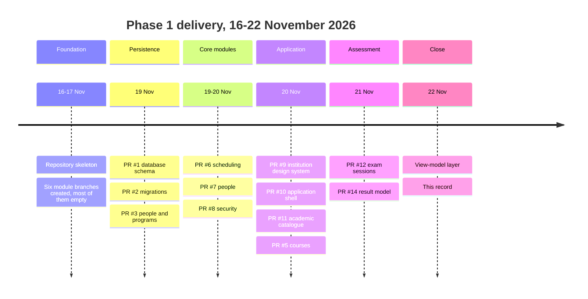
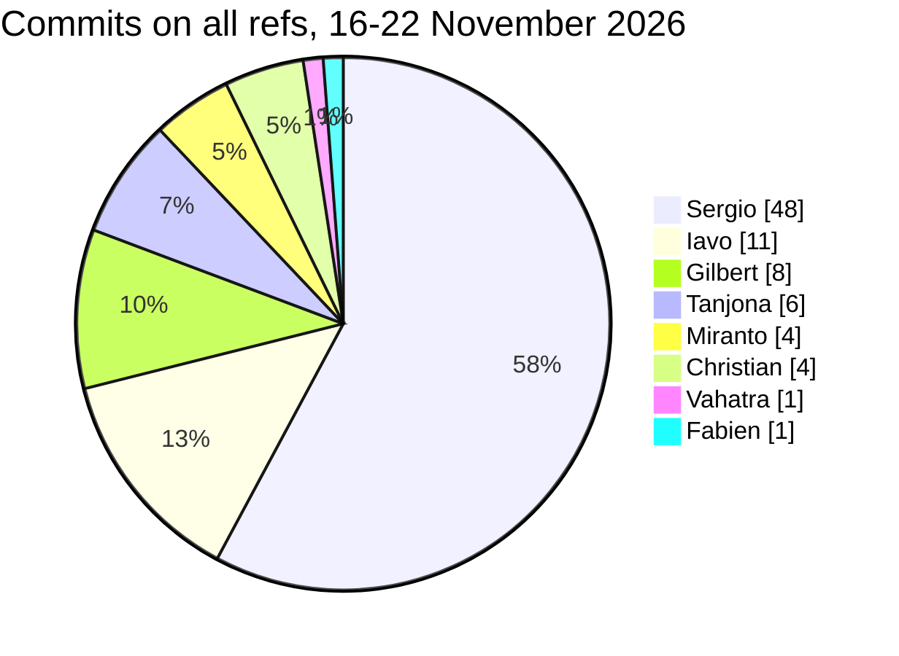
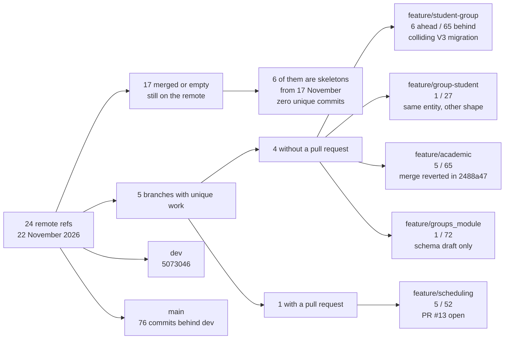
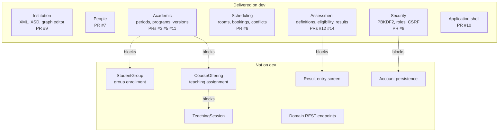
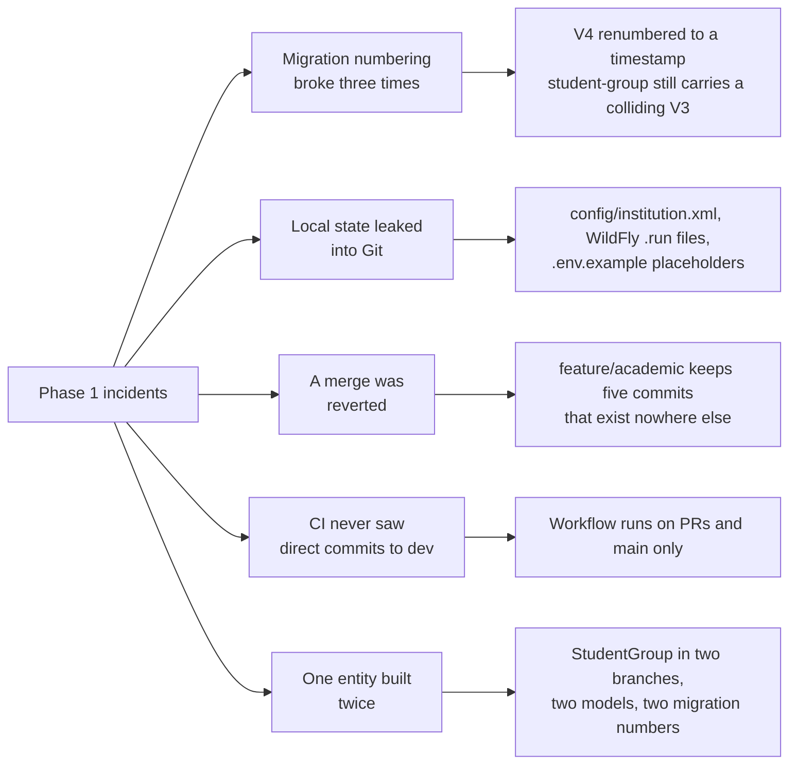

# Phase 1 delivery record

Status: **record of the week of 16–22 November 2026.**

Written on 22 November 2026. `dev` head at the time of writing: `5073046`.
The numbers come from Git and the GitHub API on that date. Branch positions move as
`dev` advances, so read them as a snapshot, not as a live view.

## Visual summary

The same diagrams are attached to issue #37, which is the board card for this record.

### The week at a glance

### Who wrote the 83 commits

Mikajy (`Heriandrisoa`) wrote no commits in phase 1, and a pie chart cannot show a zero slice.

### Branch lifecycle

### What reached `dev`, by module

### Incidents

## 1. Delivery outcomes

| Area | Outcome | Evidence |
| --- | --- | --- |
| Institution | XML configuration, XSD and semantic validation, graph editor, design-system pass, professor read-only rule | PR #9, `adaf404` |
| People | Students and teachers, JPA persistence, list, search and create page | PR #7 |
| Academic catalogue | Periods, programs, courses, program versions and program enrollment in the application layer | PRs #3, #5, #11 |
| Scheduling | Rooms, bookings, conflict check in Java and a PostgreSQL exclusion constraint | PR #6 |
| Security | PBKDF2 passwords, login and logout, roles, CSRF, request filters, account creation in memory | PR #8 |
| Assessment | Assessment definitions, eligibility and the result model | PR #14 |
| Exam sessions | Scheduling, invigilators, cancellation and the shared booking service | PR #12 |
| Application shell | Authenticated JSP application with all eight module pages | PR #10 |
| UI baseline | Design tokens applied, shared fragments, validation summaries and the page view-model layer | `5073046` |

Not delivered in phase 1:

- `StudentGroup` on `dev`
- group enrollment
- `CourseOffering`
- teaching assignment
- `TeachingSession`
- result entry
- domain REST endpoints
- account persistence

## 2. Commits

83 commits on all refs between 16 and 22 November 2026.

| Author identity | Commits |
| --- | --- |
| Sergio (`sergiorandria`, `Sergio Randriamihoatra`) | 48 |
| Iavo (`IavoAmbinintsoa`) | 11 |
| Gilbert (`NiainaGilbert`, `RAKOTOARISON Niaina Gilbert`) | 8 |
| Tanjona (`Mokabe000`) | 6 |
| Miranto (`Tsifeherana`) | 4 |
| Christian (`herimanantsoa51`) | 4 |
| Vahatra (`vahatraSylvio23`) | 1 |
| Fabien (`Fabien-Halaby`) | 1 |
| Mikajy (`Heriandrisoa`) | 0 |

The two Sergio identities and the two Gilbert identities are the same people using different
Git configurations. The counts above merge them.

## 3. Pull requests

Twelve merged, two open.

| PR | Branch | State | Merged |
| --- | --- | --- | --- |
| #1 | `feat/bdd_V1` | Merged | 2026-11-19 |
| #2 | `feat/migration_V2` | Merged | 2026-11-19 |
| #3 | `feat/people-academic-programs` | Merged | 2026-11-19 |
| #5 | `feat/course_module` | Merged | 2026-11-20 |
| #6 | `feature/scheduling` | Merged | 2026-11-19 |
| #7 | `feature/people` | Merged | 2026-11-20 |
| #8 | `feature/security` | Merged | 2026-11-20 |
| #9 | `feature/institution-design-system` | Merged | 2026-11-20 |
| #10 | `feature/app-servlets` | Merged | 2026-11-20 |
| #11 | `features/academic_` | Merged | 2026-11-20 |
| #12 | `feature/assessment` | Merged | 2026-11-21 |
| #14 | `feature/assessment-result-model` | Merged | 2026-11-21 |
| #4 | `dev` | Open | — |
| #13 | `feature/scheduling` | Open | — |

## 4. Branch lifecycle

24 remote refs at the end of phase 1. Seventeen of them contain nothing that is not already on
`dev`, yet all seventeen still exist.

### 4.1 Merged or empty, still on the remote

`feat/bdd_V1`, `feat/course_module`, `feat/migration_V2`, `feat/people-academic-programs`,
`feature/app-servlets`, `feature/assessment`, `feature/assessment-result-model`,
`feature/enrollment`, `feature/exam-scheduling`, `feature/grade-management`,
`feature/institution`, `feature/institution-design-system`, `feature/integration-tests`,
`feature/people`, `feature/security`, `feature/xml-configuration`, `features/academic_`.

Six of these — `feature/enrollment`, `feature/exam-scheduling`, `feature/grade-management`,
`feature/institution`, `feature/integration-tests` and `feature/xml-configuration` — are
skeletons from 17 November with zero unique commits. They make the branch list harder to read.

### 4.2 Unmerged work without a pull request

| Branch | Ahead / behind `dev` | Last commit | Author | Risk |
| --- | --- | --- | --- | --- |
| `feature/student-group` | 6 / 65 | 2026-11-19 | Gilbert | Duplicate of the next row; carries a `V3` migration that collides with `V3__academic_course.sql` |
| `feature/group-student` | 1 / 27 | 2026-11-20 | Gilbert | Same entity, different shape |
| `feature/academic` | 5 / 65 | 2026-11-19 | Gilbert | Its merge was reverted in `2488a47` |
| `feature/groups_module` | 1 / 72 | 2026-11-18 | Gilbert | Schema draft only |

### 4.3 Unmerged work with a pull request

| Branch | Ahead / behind `dev` | Pull request |
| --- | --- | --- |
| `feature/scheduling` | 5 / 52 | #13 |

### 4.4 Integration refs

| Ref | State |
| --- | --- |
| `dev` | `5073046`, clean, deployed locally |
| `main` | Last moved on 18 November, **76 commits behind `dev`** |

## 5. Incidents

1. **Migration numbering broke three times.** `V4` had to be renumbered to a timestamp in
   `bbd66b5`; migrations were made consistent and `flyway clean` was enabled in `1177f53`;
   `feature/student-group` still carries a `V3` that collides with `V3__academic_course.sql`.
2. **Local state leaked into Git.** `config/institution.xml` was tracked and had to be removed in
   `88fe838`; WildFly `.run` files were removed in `c134a46`; `.env.example` placeholders were
   restored in `859addf`.
3. **A merge was reverted.** `2488a47` reverted the `feature/academic` merge, leaving that branch
   with five commits that exist nowhere else.
4. **CI never saw most of this.** The workflow runs on pull requests and `main` only, so the
   direct commits to `dev` were not tested by CI.
5. **Two people built the same entity twice.** `StudentGroup` exists in two branches with
   different models and two migration numbers.

## 6. Carried into phase 2

| Milestone | Issues |
| --- | --- |
| M1 Teaching path | #16–#21, parent #15 |
| M2 Platform and DevOps | #22–#28 |
| M3 Scheduling hardening | #29–#31 |
| M4 Assessment UI | #32–#34 |
| M5 Academic UI and security | #35–#36 |

The board is <https://github.com/orgs/DEV-L3-MISA-2026/projects/6>.

## 7. Housekeeping

Not scheduled yet:

- delete the seventeen merged or empty branches after confirming nothing unique is in them;
- bring `main` up to `dev` once, so the default branch is not 76 commits stale;
- close PR #4 if its content is already on `dev`.
